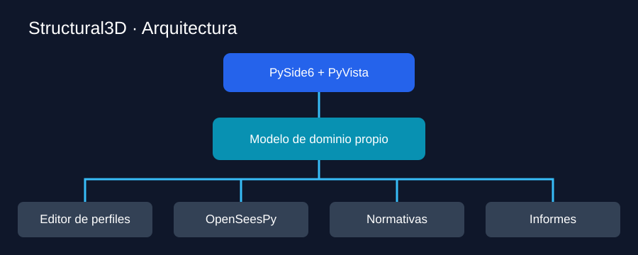
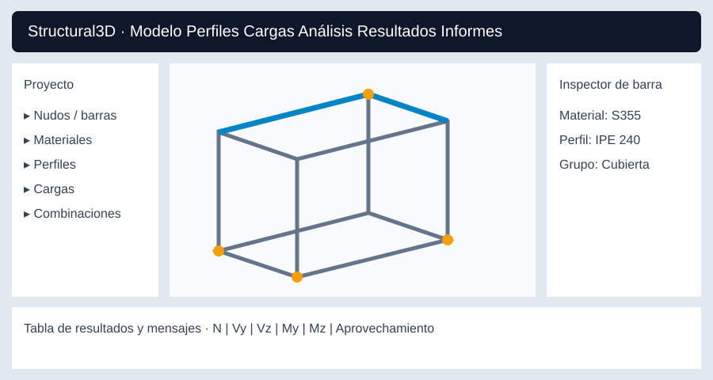
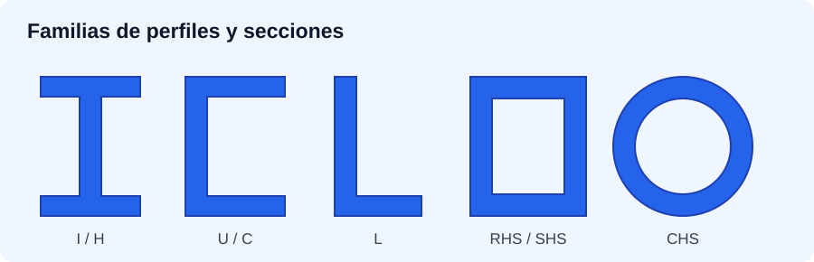
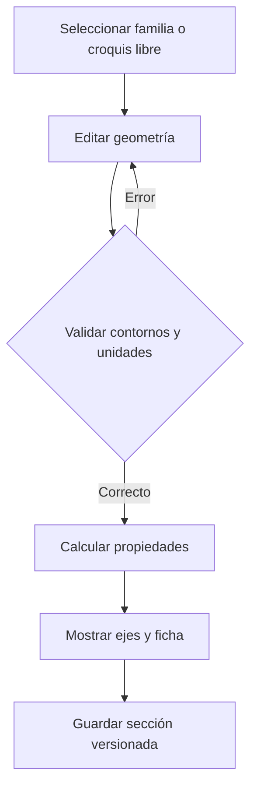
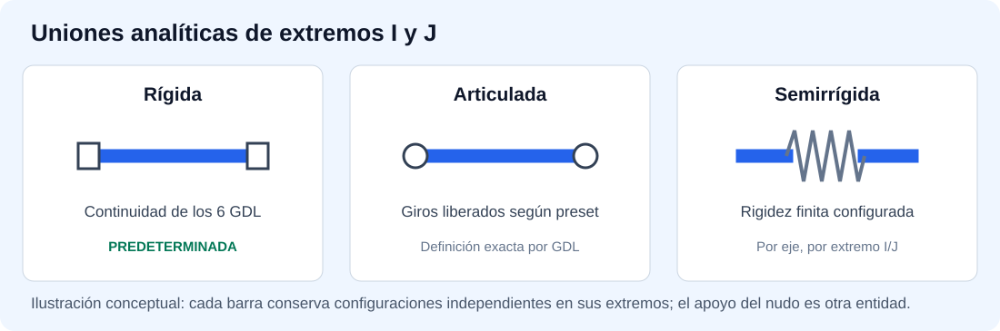
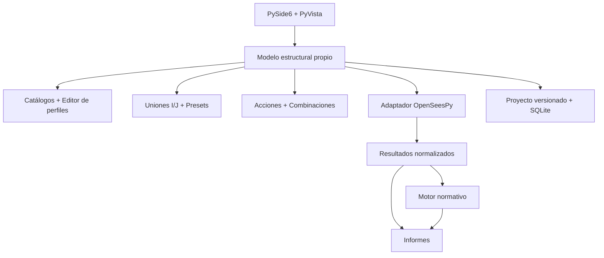
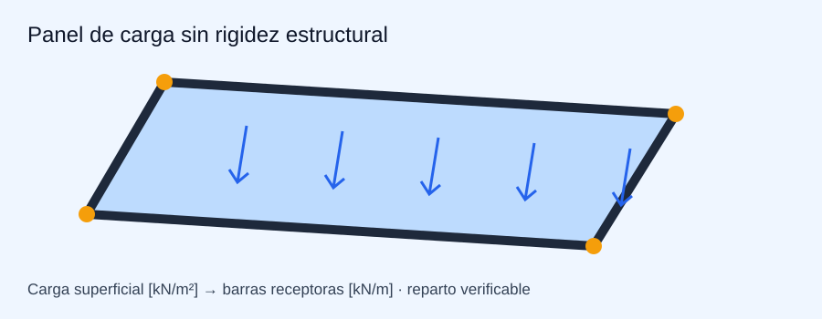

# Veritas Structural Calculation 3D — Propuesta completa de aplicación estructural

**Versión:** 1.1.0 · **Fecha:** 24.10.2026 · **Estado:** Propuesta actualizada para desarrollo experimental con Codex.

> Aplicación 3D de barras y nudos, inspirada funcionalmente en CYPE 3D para modelado y RSTAB para análisis de resultados, con OpenSeesPy como motor FEM. Soporta acero, aluminio y madera, con **un único material por barra**. **Todas las conexiones analíticas entre extremos de barras y nudos son rígidas por defecto y editables individualmente.** No contempla el dimensionamiento constructivo de tornillos, soldaduras ni placas de conexión.



## 1. Visión del producto

Una aplicación de escritorio Windows, escrita principalmente en Python, capaz de crear estructuras espaciales, asignar materiales y perfiles, administrar cargas y combinaciones, calcular respuestas, realizar comprobaciones normativas, inspeccionar resultados y producir informes personalizables. Experimental y funcionalmente completa, **no certificada para justificar obras reales** sin validación independiente.

**Principios:** modelo de dominio propio independiente de OpenSeesPy; unidades SI internas; persistencia versionada; comandos reversibles; trazabilidad del cálculo y pruebas para cada módulo.

## 2. Matriz general de módulos

| Módulo | Funciones previstas |
|---|---|
| Modelador | Nudos, barras, grupos, rejillas, plantas, captura, copiar, dividir, mover, girar, simetría, selección y undo/redo |
| Propiedades | Material, perfil, orientación local, excentricidad, liberaciones de extremos, rigideces y apoyos |
| **Uniones analíticas** | **Rígidas por defecto; articuladas, semirrígidas y liberaciones por GDL; configuración independiente en extremos I y J; edición gráfica y presets** |
| Materiales | Acero, aluminio y madera; catálogos y materiales personalizados; densidades y propiedades mecánicas |
| **Biblioteca de perfiles** | Familias extensivas, series, búsqueda avanzada, importación, comparación y trazabilidad |
| **Editor de perfiles** | Secciones paramétricas y libres, croquis, huecos, ejes, propiedades calculadas y validación |
| Cargas | Puntuales, distribuidas, peso propio, paneles, viento, nieve, temperatura e imperfecciones |
| Combinaciones | Casos, hipótesis, acciones incompatibles, combinaciones ELU/ELS y envolventes |
| FEM | Lineal, segundo orden P-Delta, modal, estabilidad bajo condiciones definidas |
| Resultados | N, Vy, Vz, Mx, My, Mz, deformadas, reacciones, tablas, filtros y mapas de utilización |
| Normativas | Plugins de Eurocódigos y anexos nacionales, versiones identificadas |
| Informes | Índices, capítulos, tablas, diagramas, imágenes 3D, PDF y exportaciones |
| Datos | Proyectos versionados, SQLite para bibliotecas, migraciones y recuperación |

## 3. Interfaz de modelado 3D



**Distribución:** cinta superior de comandos; árbol de proyecto a la izquierda; visor 3D central; inspector de objetos a la derecha; tabla de edición y consola de incidencias debajo. Modos: Modelo, **Uniones**, Perfiles, Cargas, Análisis, Normativas, Resultados e Informes.

Edición gráfica de nudos y barras; coordenadas absolutas/relativas; snapping; rejillas; orientación de ejes locales; selección múltiple y por ventana; filtros por elemento/material/perfil/grupo; zoom, vistas ortográficas, perspectiva, capas y elementos aislados; cambios por selección múltiple. **El usuario podrá seleccionar visualmente el extremo I o J de una barra y editar su unión en el inspector**, así como copiar configuraciones a selecciones múltiples. La geometría persistida será independiente de la escena PyVista.

## 4. Biblioteca extensiva de perfiles



La biblioteca será una **base de datos extensible**, no una lista codificada. Separará catálogos de referencia inmutables de perfiles personalizados del usuario.

| Material | Familias iniciales | Ampliaciones previstas |
|---|---|---|
| Acero | I/H, U/C, L igual/desigual, T, Z, RHS, SHS, CHS, planos y redondos | Conformados en frío, soldados y secciones especiales |
| Aluminio | I, U, T, L, RHS, SHS, CHS, macizos | Extrusiones específicas de fabricantes |
| Madera | Rectangulares, cuadrados, redondos, madera maciza y laminada homogénea | GL, LVL y productos especiales según modelos y normativa |

**Ficha del perfil:** ID, nombre, familia, dimensiones, radios/espesores, croquis acotado, fuente, norma, edición/revisión, procedencia, unidad original, material compatible, datos nominales/publicados y valores calculados. Propiedades: área A; centroide; Iy, Iz, Iyz; ejes principales; radios de giro; módulos resistentes elásticos, módulos plásticos cuando corresponda; constante torsional J y alabeo Cw cuando estén implementados; perímetro y masa por longitud derivada de densidad.

**Herramientas de catálogo:** búsqueda con múltiples filtros; orden por dimensiones, área, masa e inercias; favoritos y recientes; comparación entre perfiles; sustitución masiva en barras; importar CSV/JSON con mapeo de columnas/unidades; exportar perfiles propios; clonar perfiles normalizados a variantes editables; deduplicación; registros de fuente, versión y validación. No se distribuirán tablas protegidas sin autorización.

**Regla crítica:** el momento polar `Iy + Iz` no sustituye a la constante torsional de Saint-Venant `J` en perfiles abiertos. Ninguna propiedad avanzada ausente deberá inventarse; se indicará **no calculada/no soportada**.

## 5. Editor y creador de perfiles

Tres modalidades:

1. **Paramétrica:** familia + dimensiones `h`, `b`, `tw`, `tf`, radios y otras variables según perfil, con dibujo actualizado en tiempo real.
2. **Geometría compuesta:** operaciones de unión y sustracción de rectángulos, círculos y polígonos homogéneos.
3. **Croquis libre 2D:** líneas, arcos, polígonos, contornos interiores y huecos, cotas, snapping y restricciones geométricas.



El editor detectará autointersecciones, contornos abiertos, huecos inválidos, espesores no positivos, áreas nulas e inconsistencias de unidades. Mostrará centroide, ejes locales/principales, valores calculados y **método de obtención**.

Las propiedades de área, centroide y momentos de inercia pueden calcularse mediante integración geométrica de polígonos; los arcos se tratarán de forma analítica o por discretización controlada. `J`, `Cw`, módulos plásticos, propiedades efectivas y clasificación normativa necesitarán algoritmos específicos por tipología y pruebas independientes. Podrán permanecer marcados como no implementados inicialmente.

**Separación conceptual:** `SectionDefinition` contiene geometría; `SectionProperties` contiene propiedades geométricas y su estado de validación; `MaterialDefinition` contiene propiedades del material. `Member` referencia exactamente una sección y un material. Una sección personalizada podrá ser geométricamente apta para FEM aunque todavía no esté cubierta por un módulo de comprobación normativa.

**Pruebas del editor:** rectángulo, círculo, anillo, I, L, caja cerrada y polígono con hueco; contrastar A, centroide e inercias con fórmulas analíticas/catálogos, con tolerancias documentadas. Guardar, reabrir y reasignar secciones sin pérdida de datos.

## 6. Uniones analíticas y condiciones de extremo



### 6.1 Regla predeterminada y alcance

**Toda barra recién creada tendrá unión rígida en sus extremos I y J.** Esto significa que, en el modelo analítico básico, el extremo comparte los desplazamientos y giros del nudo al que está conectado, sin liberaciones ni resortes de conexión. Una unión rígida no significa un empotramiento al terreno: **los apoyos del nudo se definen por separado**.

Una unión analítica representa la transferencia de esfuerzos de un miembro a un nudo. Se incluyen conexiones rígidas, articuladas, parcialmente liberadas y semirrígidas, **sin** diseño constructivo de placas, pernos, soldaduras o detalles locales. Las condiciones del extremo I y del extremo J deben ser independientes, incluso cuando varias barras comparten un mismo nudo. La definición de unión pertenece al **extremo de la barra**, no al nudo global, evitando que una liberación de un miembro altere automáticamente a los demás.

### 6.2 Grados de libertad configurables

| GDL local del extremo | Esfuerzo asociado | Predeterminado | Opciones |
|---|---|---|---|
| Ux | Axial N | Rígido | Rígido, liberado, resorte axial |
| Uy | Cortante Vy | Rígido | Rígido, liberado, resorte traslacional |
| Uz | Cortante Vz | Rígido | Rígido, liberado, resorte traslacional |
| Rx | Torsión Mx | Rígido | Rígido, liberado, resorte torsional |
| Ry | Flexión My | Rígido | Rígido, liberado, resorte rotacional |
| Rz | Flexión Mz | Rígido | Rígido, liberado, resorte rotacional |

Para cada extremo se almacenarán los seis GDL como estados independientes. **Rígido** representa continuidad cinemática; **liberado** no transmite la componente de esfuerzo conjugada en el modelo idealizado; **resorte** permite transferencia proporcional a desplazamiento/giro relativo mediante rigidez finita no negativa. Las rigideces se expresarán en unidades consistentes, por ejemplo N/m para traslación y Nm/rad para rotación en el sistema SI interno. Los valores cero o infinitos no se introducirán como constantes numéricas arbitrarias: se representarán como estados liberado/rígido. Se prohibirán rigideces negativas salvo modelo especializado expresamente validado.

**Presets editables:** rígida (predeterminada), articulación espacial habitual (liberaciones a flexión de extremo en los ejes relevantes, conservando transmisión axial/cortante según definición), unión con liberación de torsión, semirrígida rotacional y configuración libre. Los presets son ayudas de interfaz; la definición exacta siempre es la matriz de seis GDL del extremo. No se asumirá que una etiqueta «articulada» significa liberar indiscriminadamente todos los GDL.

### 6.3 Excentricidades y conexión geométrica

- Offset/excentricidad de extremos I/J, con coordenadas de referencia y transformación local/global explícitas.
- Distinción entre eje analítico de la barra, punto de unión al nudo y geometría de visualización.
- Compatibilidad de offsets con cargas, rigideces, resultados y representación gráfica; advertencia para combinaciones no soportadas.
- Las liberaciones se aplicarán en la ubicación analítica declarada; no se inferirá automáticamente un brazo rígido cuando el usuario introduzca un desplazamiento geométrico sin definir su comportamiento.

### 6.4 Flujo de usuario y editor gráfico

1. Crear barra: los extremos I y J se inicializan como **RÍGIDOS**.
2. Seleccionar barra o icono de extremo en la vista 3D; elegir I, J o ambos.
3. Abrir inspector «Unión analítica» con seis filas de GDL, preset y rigideces.
4. Cambiar estado por GDL, introducir rigideces/unidades y offsets; previsualizar símbolos sin ejecutar el solver.
5. Validar configuración, confirmar y permitir copiar/pegar o aplicar a varias barras.
6. Guardar historial reversible (undo/redo), invalidar análisis dependientes y mostrar el símbolo/etiqueta de la unión.

La visualización distinguirá por icono una unión rígida, articulada, semirrígida, liberación axial, torsional o parcial; se podrá mostrar/ocultar por filtro, extremo, tipo y grupo. La tabla editable de uniones expondrá una fila por extremo de barra, con ID de barra, I/J, nudo, preset y seis estados. Las propiedades podrán copiarse entre barras sin perder su orientación de ejes locales.

### 6.5 Modelo de datos y OpenSeesPy

Entidades sugeridas: `MemberEndConnection(member_id, end, dof_states, offsets, preset_id, revision)`, `ConnectionPreset`, `ConnectionSpring` y `ConnectionValidationIssue`. `Member` hará referencia a dos configuraciones de extremo **obligatorias**, nunca nulas. La vista «Nudo» mostrará las conexiones individuales de las barras incidentes, pero no las fusionará.

El adaptador FEM seleccionará una técnica compatible con cada elemento y combinación de GDL: liberaciones nativas donde estén soportadas, nodos internos auxiliares más restricciones cinemáticas y elementos de resorte/longitud cero cuando proceda, o rechazo explícito de configuraciones incompatibles. **No se supondrá que OpenSeesPy tiene un comando universal que admita cualquier combinación de seis liberaciones en todos los tipos de elemento.** La creación de nodos auxiliares conservará la identidad de barra y extremo para postprocesado e informes. Se documentará el tratamiento de masas, offsets, grados de libertad y reacciones en cada formulación.

El validador comprobará simultáneamente: ausencia de mecanismos, grados de libertad huérfanos, liberaciones redundantes, resortes de rigidez inválida, compatibilidad con el tipo de elemento y coherencia de ejes. Las configuraciones singulares se mostrarán como errores de modelo antes o durante la ejecución, no como resultados numéricos correctos.

### 6.6 Requisitos verificables de uniones

| ID | Prioridad | Criterio funcional |
|---|---|---|
| CON-001 | P0 | Ambos extremos rígidos al crear cualquier barra nueva. |
| CON-002 | P0 | Estados I/J independientes y persistentes. |
| CON-003 | P1 | Estados rígido/liberado/resorte para seis GDL locales por extremo. |
| CON-004 | P1 | Rigidez numérica traslacional/rotacional con unidades y validación. |
| CON-005 | P1 | Presets de unión rígida, articulada, semirrígida y personalizada. |
| CON-006 | P1 | Offsets/excentricidades I/J con ejes de referencia explícitos. |
| CON-007 | P1 | Biblioteca de presets personalizada, exportable y reutilizable. |
| CON-008 | P1 | Selección y edición visual de extremos; símbolos, filtros y asignación masiva. |
| CON-009 | P1 | Detección de mecanismos y incompatibilidades sin resultados falsamente válidos. |
| CON-010 | P1 | Informes y tablas con propiedades de unión por barra/extremo. |
| CON-011 | P1 | Traducción FEM de configuraciones soportadas y mensaje explícito para las no soportadas. |
| CON-012 | P1 | Historial y pruebas de regresión de uniones en proyectos guardados. |

**Pruebas de aceptación esenciales:** (a) barra creada sin edición → rigidez total en ambos extremos; (b) liberar Ry/Rz solo en I no altera J ni otros miembros del nudo; (c) viga biapoyada con articulaciones adecuadas reproduce reacciones y momentos analíticos; (d) añadir resorte rotacional finito produce comportamiento intermedio y tendencia correcta al aumentar/disminuir la rigidez; (e) liberar GDL que convierten la estructura en mecanismo genera diagnóstico; (f) guardar/reabrir preserva seis estados y rigideces de I/J; (g) editar unión invalida resultados existentes.

## 7. Arquitectura de software

| Capa | Tecnología | Responsabilidad |
|---|---|---|
| GUI | PySide6 | Menús, tablas, inspector, editores |
| Modelo 3D | PyVista + VTK | Renderizado, selección, diagramas, deformadas |
| Dominio | Python tipado + Pydantic | Entidades, comandos, validación, unidades |
| FEM | OpenSeesPy | Modelo espacial, análisis y recuperación de resultados |
| Numérico | NumPy + SciPy | Álgebra, geometría, postproceso y auxiliares |
| Bibliotecas | SQLite + SQLAlchemy | Catálogos, versiones y datos de perfil |
| Normativa | Plugins Python | Cargas, factores y comprobaciones |
| Informes | Jinja2 + WeasyPrint | HTML/PDF configurable |
| Pruebas | pytest | Ensayos unitarios, integración y regresión |



**Entidades:** `Project`, `Node`, `Member`, `Support`, `MemberEndConnection`, `ConnectionPreset`, `ConnectionSpring`, `ConnectionValidationIssue`, `MaterialDefinition`, `SectionDefinition`, `SectionProperties`, `LoadPanel`, `LoadCase`, `Load`, `LoadCombination`, `AnalysisConfiguration`, `AnalysisRun`, `MemberResult`, `DesignCheck`, `ReportTemplate`.

Cada análisis será reproducible: versión del modelo y perfiles, edición normativa, configuración del solver, registro de errores y resultados asociados. Los cálculos largos se ejecutarán en proceso separado, con cancelación y manejo de fallos. Para combinaciones lineales se permitirá superposición cuando corresponda; los casos no lineales requerirán cálculo específico.

## 8. Cargas y paneles



**Paneles:** superficies geométricas sin rigidez FEM por defecto que reparten acciones a las barras receptoras. Métodos tributario, unidireccional, bidireccional u otros, cada uno documentado y validado por equilibrio. Vista gráfica de áreas tributarias, sentido de carga y fuerzas equivalentes.

**Asistentes:** peso propio, viento (zonificación, dirección, presión/succión, exposición, coeficientes), nieve (zona, altitud, pendientes, acumulación), cargas térmicas e imperfecciones iniciales o equivalentes. Entrada dependiente de edición normativa/anexo nacional; parámetros y resultados auditables. Evitar duplicación entre cargas equivalentes y geometría perturbada.

**Gestión:** casos permanentes/variables, variantes mutuamente excluyentes, grupos de simultaneidad, combinaciones ELU y ELS y envolventes con identificación del caso gobernante.

## 9. Análisis y vistas tipo RSTAB

Análisis estático lineal de estructuras espaciales; segundo orden P-Delta; modos propios; estabilidad en fases concretas y bien delimitadas. No confundir autovalores de pandeo o P-Delta con comprobaciones normativas completas de estabilidad y pandeo lateral-torsional.

Mostrar: N, Vy, Vz, torsión, My, Mz, desplazamientos, giros, reacciones, deformadas con escala configurable, diagramas por estaciones, valores máximos/mínimos, envolventes y razón demanda/capacidad. Tablas y vista 3D sincronizadas.

Filtros por caso/combinación, barra, grupo, sección, familia, material, nivel, selección visible, rango de valores, utilización y verificación gobernante. Vistas guardadas y leyendas con unidades y signos documentados.

## 10. Normativas independientes

Módulos iniciales previstos: **EN 1990** (bases/combinaciones), **EN 1991** (acciones), **EN 1993** (acero), **EN 1995** (madera) y **EN 1999** (aluminio). La segunda generación de Eurocódigos hace imprescindible registrar **edición exacta y anexo nacional**. Futuro módulo SIA para Suiza, completamente separado.

Comprobaciones progresivas: sección, axil, flexión, cortante, torsión, interacción, estabilidad y flechas según material/familia y alcance implementado. Resultado con ecuación, cláusula, parámetros y estado explícito: `aprobado`, `incumplido`, `no aplicable` o `no comprobado`. Nunca mostrar aprobado cuando la propiedad, hipótesis o regla requerida esté ausente.

## 11. Informes personalizables

Plantillas por proyecto con capítulos configurables: portada, índice, hipótesis, unidades, versión normativa, estructura, nudos/barras, materiales, catálogo de perfiles usados, apoyos, **uniones analíticas I/J con sus seis GDL, rigideces y offsets**, cargas y paneles, combinaciones, configuración de análisis, resultados, envolventes, aprovechamientos, incidencias y anexos. Tablas filtrables, imágenes de vistas 3D, diagramas, firma/versiones y PDF/HTML. Registrar hash del modelo, motor, catálogos y normativa para reproducibilidad.

## 12. Organización del repositorio

```text
structural3d/
├── app/                     # Inicio y configuración
├── core/
│   ├── geometry/            # Nudos, barras y operaciones
│   ├── materials/           # Materiales
│   ├── sections/            # Geometría y propiedades
│   ├── supports/            # Apoyos y restricciones del nudo
│   ├── connections/         # Uniones analíticas I/J, presets, resortes
│   └── loads/               # Acciones y combinaciones
├── catalogs/                # Base de datos, importadores, validación
├── section_editor/          # Croquis 2D, paramétricos y propiedades
├── fem/                     # Adaptadores, solvers, resultados
├── design_codes/            # EN 1990, 1991, 1993, 1995, 1999
├── gui/                     # Modelador, tablas, inspector, resultados
├── reports/                 # Plantillas y PDF
├── persistence/             # Archivos de proyecto y migraciones
├── tests/                   # Ensayos analíticos y regresión
└── docs/                    # Manual y especificaciones
```

## 13. Hoja de ruta de desarrollo con Codex

| Fase | Desarrollo | Entregable verificable |
|---|---|---|
| 0 | Especificación detallada, entidades, unidades, convenciones y ensayos patrón | Contratos y backlog aprobados |
| 1 | Núcleo barras/nudos + uniones rígidas I/J predeterminadas + FEM + cargas básicas | Viga/cercha/pórtico validados, uniones rígidas por defecto |
| **2** | **Biblioteca extensa de perfiles**, datos de catálogo, importador y filtros | Buscar, comparar, asignar y persistir perfiles |
| **3** | **Editor de perfiles** paramétrico y libre; cálculo y validación | Secciones contrastadas con casos analíticos |
| 4 | Modelador 3D con inspector, edición de extremos/uniones, guardado y undo/redo | Crear estructura y editar uniones I/J sin programar |
| 5 | Paneles, viento/nieve, imperfecciones y combinaciones | Equilibrio y casos reproducibles |
| 6 | Diagramas, envolventes, filtros, deformadas y tablas | Resultados contrastados |
| 7 | Plugins normativos: acero primero, aluminio/madera progresivamente | Comprobaciones trazables y ensayadas |
| 8 | Informes, importación/exportación, instalador y QA | Versión experimental integral |

**Codex como desarrollador:** tickets pequeños con alcance y aceptación explícitos; `AGENTS.md` con reglas arquitectónicas; pruebas automáticas antes de integrar cada módulo; revisiones del modelo de datos y API antes de ampliar funciones. La verificación de ingeniería deberá ser independiente del código generado.

## 14. Riesgos prioritarios y límites

1. **Propiedades avanzadas de secciones:** torsión, alabeo, módulos plásticos y secciones efectivas son difíciles de generalizar, especialmente para formas abiertas y delgadas.
2. **Pandeo y estabilidad:** el análisis de barras no sustituye verificaciones de longitud de pandeo, arriostramiento y pandeo lateral-torsional.
3. **Paneles de carga:** el método de reparto debe declararse y verificarse con equilibrio y ejemplos de referencia.
4. **Combinaciones:** la superposición lineal no es válida para resultados de análisis no lineales en general.
5. **Catálogos y normas:** origen, derechos de reproducción, revisión y licencias deben comprobarse antes de distribuir datos.
6. **Seguridad:** no utilizar resultados para dimensionamiento real sin validación técnica independiente del software y del modelo.
7. **Uniones y mecanismos:** liberar GDL de forma incorrecta o modelar resortes auxiliares sin restricciones coherentes puede introducir singularidades o resultados físicamente incorrectos; se requieren pruebas analíticas y de regresión específicas.

## 15. Decisiones iniciales recomendadas

- **Arquitectura A:** escritorio PySide6 + PyVista + OpenSeesPy, Windows primero.
- **Diseño completo desde el inicio**, implementación por fases e hitos verificables.
- **Primer catálogo:** familias europeas de acero, ampliando aluminio y madera con tablas verificadas.
- **Primer editor:** secciones paramétricas, polígonos con huecos, A/centroide/inercias; ampliar gradualmente J, Cw y cálculos normativos.
- **Primer vertical funcional:** nudos → barras (uniones rígidas I/J) → perfil/material → apoyos → cargas → OpenSeesPy → resultados → informe.

## 16. Referencias técnicas

- [Documentación OpenSeesPy](https://openseespydoc.readthedocs.io/)
- [OpenSees: cargas sobre elementos](https://opensees.github.io/OpenSeesDocumentation/user/manual/model/pattern/PlainPatternloadcommands/eleLoad.html)
- [PyVistaQt: integración en Qt](https://github.com/pyvista/pyvistaqt/blob/main/docs/usage.rst)
- [PyVista: selección de elementos](https://docs.pyvista.org/api/plotting/_autosummary/pyvista.plotter.enable_element_picking.html)
- [Comisión Europea: Eurocódigos](https://single-market-economy.ec.europa.eu/sectors/construction/other-standardisation-initiatives-construction/eurocodes_en)
- [JRC: segunda generación Eurocódigos](https://eurocodes.jrc.ec.europa.eu/2nd-generation/second-generation-eurocodes-what-new)

---

**Siguiente documento aconsejado:** especificación de requisitos (SRS) con criterios de aceptación, modelo ER, API de perfiles, estrategia de datos licenciados, matriz de verificaciones y backlog para Codex.
